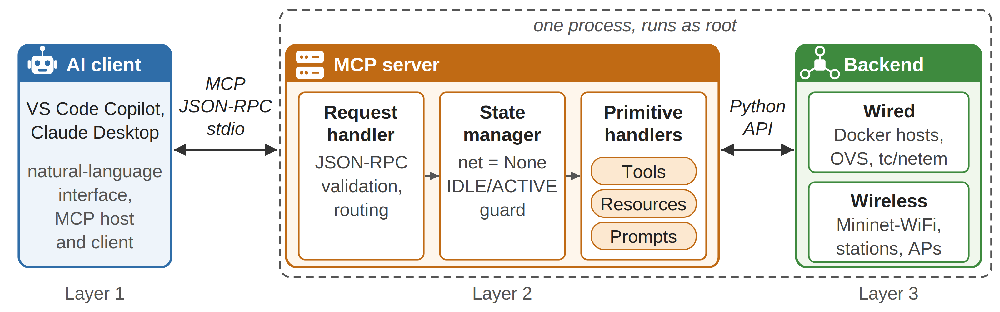

# MCP Server Architecture

---

## 1. Overview

This project implements a three-layer architecture that connects an AI client
to a real network emulation backend via the Model Context Protocol (MCP).
The system enables a researcher to control and measure network topologies
using natural language and no manual CLI commands or Python scripts required.
This project integrates MCP with a network emulation environment combining
Containernet and Mininet-WiFi capabilities.

**Layer 1 — AI Client:**
VS Code Copilot is used as the primary tool. The user types a
natural language prompt. The AI client can use the registered MCP tool schemas
to select tools,
supply arguments, and execute operations based on the user's request.
The exact workflow depends on the client and its configuration.

**Layer 2 — MCP Server:**
server.py exposes 10 tools, 3 resources, and 2 prompts to the AI client via
JSON-RPC 2.0 over stdio transport. Runs as root via passwordless sudo.

**Layer 3 — Unified Backend:**
ramonfontes/containernet — combines Containernet Docker host support and
Mininet-WiFi wireless support in one Python process. A single Containernet()
net object manages all node types simultaneously.

## Architecture Diagram

---

## 2. Unified Backend

**Repository:** ramonfontes/containernet
**Setup:** PYTHONPATH must point to your local containernet-wifi installation.
See README.md for full installation instructions.

One Containernet() net object manages all of the following simultaneously:
- Docker hosts (wired segment)
- OVS switches (wired segment)
- Docker WiFi stations / DockerSta (wireless segment)
- Access points (wireless segment)
- Regular Mininet-WiFi stations (mesh segment)

**Global state:**
  net = None  # set by create_topology(), cleared by destroy_topology()

**Topology lifecycle:**
  IDLE -> create_topology() -> ACTIVE -> destroy_topology() -> IDLE

Topology-dependent tools check whether a topology is active. Depending on
the tool, an inactive topology may produce an error response or a returned
message indicating that no topology is active.

**Launch:**
  sudo python3 server.py

**VS Code Copilot config:** .vscode/mcp.json
**Custom Docker image:** mcp-network-node (extends ramonfontes/bmv2 with
iperf, telnet, iproute2, iputils-ping)

---

## 3. Topology Types

| Type     | Technology            | Verified Use Cases           |
|----------|-----------------------|------------------------------|
| wired    | Docker + OVS          | UC1a, UC1b, UC1c, UC1d, UC1e |
| wireless | DockerSta + hostapd   | UC2a, UC2b, UC2c, UC2d       |
| hybrid   | Docker + OVS + WiFi   | UC3a, UC3b                   |
| mesh     | IEEE 802.11s stations | UC4                          |

**Docker (Containernet):**
Docker containers used as network hosts. Each container gets a real Linux
network stack and the ability to run real tools like iperf and ping inside
an isolated environment.

**OVS (Open vSwitch):**
Software-defined OpenFlow switch that forwards packets between Docker hosts.
Managed by an OpenFlow controller (c0).

**DockerSta:**
Docker container with a virtual WiFi interface provided by mac80211_hwsim.
Combines Docker container isolation with Mininet-WiFi wireless simulation,
allowing WiFi stations to run real applications inside containers.

**hostapd:**
Linux access point daemon managing WiFi authentication, association, and
channel assignment for connected stations.

**IEEE 802.11s:**
The wireless mesh networking standard. Each station joins the same mesh
network independently. Traffic routes through the mesh without a central
access point.

**mac80211_hwsim:**
Linux kernel module that creates virtual WiFi radios enabling wireless
simulation without physical hardware. Load before wireless sessions:
  sudo modprobe mac80211_hwsim radios=4

**Host distribution:** assigned to switches in round-robin order.
**Station distribution:** assigned to APs in round-robin order.
**WiFi association wait:** 10 seconds after net.start().

---

## 4. MCP Primitives

### 4.1 Tools (10) — state-changing or active measurement

| Tool              | Backend      | Implementation               |
|-------------------|--------------|------------------------------|
| create_topology   | Both         | net.addDocker(), net.start() |
| destroy_topology  | Both         | net.stop()                   |
| set_delay         | Containernet | TCIntf.config(delay=)        |
| set_bandwidth     | Containernet | TCIntf.config(bw=)           |
| set_loss          | Containernet | TCIntf.config(loss=)         |
| ping              | Both         | net.pingFull()               |
| run_iperf         | Both         | node.cmd() direct approach   |
| set_channel       | Mininet-WiFi | ap.wintfs[0].setChannel()    |
| get_routing_table | Containernet | node.cmd('ip route')         |
| get_wifi_stats    | Mininet-WiFi | AP channel + station dump    |

### 4.2 Resources (3) — read-only, no state change

| URI                   | Returns                                    |
|-----------------------|--------------------------------------------|
| topology://nodes      | All active nodes grouped by type           |
| topology://links      | All wired links in active topology         |
| topology://links/wifi | WiFi station associations per AP with RSSI |

### 4.3 Prompts (2) — reusable experiment templates

| Prompt               | Purpose                          |
|----------------------|----------------------------------|
| link_impairment_test | Guided wired link delay test     |
| wifi_channel_test    | Guided WiFi channel optimisation |

---

## 5. Internal MCP Server Flow

1. **User types a natural language prompt in VS Code Copilot.**
   The prompt describes the desired network operation in plain English,
   with no requirement to know tool names or parameters.

2. **Copilot can use the registered tool schemas to select tools and arguments.**
   The client determines which tools to call and in what order based on
   the user's request, the available tools, and the client configuration.

3. **Each tool call is sent to server.py as a JSON-RPC 2.0 message over stdio.**
   The message contains the tool name and arguments in structured JSON.
   FastMCP handles protocol parsing and routes the call to the correct
   Python function.

4. **server.py checks topology state where required.**
   Depending on the tool, an inactive topology may cause a ValueError
   or return a message such as "No active topology." This prevents
   topology-dependent operations from proceeding without an active network.

5. **Tool function executes against the live Containernet backend.**
   The function retrieves node objects from the active net, performs the
   requested operation, and returns a human-readable result string.

6. **Result is returned to Copilot which presents it to the user
   in natural language.**
   Copilot reads the result and often adds its own analysis — for example
   comparing before and after RTT values or deciding whether a channel
   switch is needed based on RSSI threshold.

---

## 6. Key Technical Decisions

### Unified Backend
Originally planned as two separate backends communicating via Unix sockets.
Based on supervisor feedback, replaced with a single ramonfontes/containernet
backend combining both Containernet and Mininet-WiFi in one process. This
eliminated backend switching logic, port conflicts, and duplicate net objects.
One net.start() call brings up the entire topology regardless of type.

### Delay on Switch-to-Switch Links
set_delay() applies the delay directly on the interface of the first node of
the link, also when both nodes are OVS switches (for example s1-eth2 for the
link between s1 and s2). In UC1c, tc qdisc shows a 100 ms netem delay on
s1-eth2, while s2-eth2 and the host-facing interfaces show noqueue, and the RTT
between h1 and h2 increases accordingly.

### run_iperf Direct Approach
net.iperf() uses telnet coordination which hangs indefinitely with Docker
nodes. The direct approach uses node.cmd() to start the iperf server on the
destination, run the iperf client from the source, and read stdout directly.
This works reliably across all topology types.

### Round-Robin Host and Station Distribution
Hosts are assigned to switches and stations to APs using a round-robin
algorithm. With 4 hosts and 2 switches: h1->s1, h2->s2, h3->s1, h4->s2.
This ensures balanced, realistic topologies regardless of the number of
nodes requested.

### stdio Transport
MCP supports stdio and SSE transports. stdio was chosen because VS Code
Copilot spawns the MCP server as a subprocess and communicates via stdin
and stdout directly. This requires no network port, no firewall configuration,
and no HTTP server — simpler and more reliable for a single-machine
research environment.

---

## 7. Error Handling

Three error categories are handled explicitly:

**State errors:** A tool is called before a topology exists. Returns:
"No active topology. Call create_topology() first."
This guides the AI to call create_topology() before any other tool.

**Argument errors:** Invalid node names or parameter values can raise
exceptions with explanatory messages. The specific response depends on
the validation performed by the individual tool.

**Backend errors:** The emulation itself fails — for example, a Docker
image is not found or an OVS bridge conflict occurs. Exceptions are recorded
by the logging wrapper in `logs/calls.jsonl` and then re-raised. The MCP
client determines how an exception is presented to the user.
