# Evaluation

## Overview

This section evaluates the MCP server for emulated networks through 12 use cases covering wired, wireless, hybrid, and mesh network scenarios. All use cases were evaluated through VS Code Copilot Agent Mode using natural-language prompts. No manual CLI commands, Python scripts, or direct API calls were used during the evaluation. The AI client selected the appropriate MCP tools, determined the sequence of tool calls, and interpreted the results.

The evaluation covers topology creation, connectivity, link impairment, throughput measurement, Wi-Fi monitoring, channel configuration, and mesh connectivity. Two additional tests evaluate the MCP prompt templates `link_impairment_test` and `wifi_channel_test`.

## MCP Server Connection

The screenshot below shows that the MCP server is running and successfully connected to VS Code Copilot. This connection allows us to interact with the emulated network using natural-language prompts and test the available MCP tools directly from VS Code.

## 1. Wired Network Use Cases

### UC1a: Basic Connectivity

**Prompt:** Create a wired topology with 2 hosts and 1 switch, then ping from h1 to h2.

**Topology:** Two hosts (`h1`, `h2`) connected to one switch (`s1`).

**Expected Result:** The topology is created successfully, and `h1` can communicate with `h2`.

**Observed Result**
- Ping from `h1` to `h2` succeeded.
- Average RTT: 1.164 ms; packet loss: 0%.

**Status: PASS** — The topology was created and connectivity was verified.

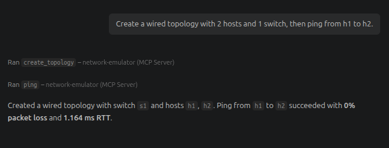

### UC1b: Delay on Host-Facing Links

**Prompt:** Create a topology with two switches and two hosts. Apply 50ms delay on h1-s1 and h2-s2. Ping from h1 to h2 and confirm RTT reflects the delay

**Topology:** Two hosts connected through two switches.

**Expected Result:** The topology is created, the specified delays are applied, and connectivity is verified.

**Observed Result**
- A 50 ms delay was configured on the specified host-facing links.
- Average RTT: 204.497 ms; packet loss: 0%.

**Status: PASS** — The delay configuration and connectivity test completed successfully.

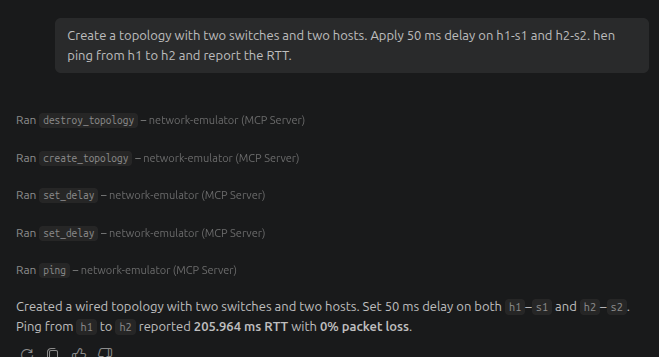

### UC1c: Delay on the Switch-to-Switch Link

**Prompt:** Create a topology with two switches and two hosts. Add 100 ms delay on the link between s1 and s2. Ping from h1 to h2 and report the round-trip time.

**Topology:** Two hosts connected through two switches.

**Expected Result:** A 100 ms delay is applied to the actual inter-switch link, increasing the RTT between the hosts.

**Observed Result**
- Average RTT: 205.926 ms; packet loss: 0%.
- Interface verification confirmed that the inter-switch link uses `s1-eth2` and `s2-eth2`.
- The `tc qdisc` output showed a 100 ms `netem` delay on `s1-eth2`. The host-facing interfaces and `s2-eth2` showed `noqueue`.
- The measured RTT was higher than the nominal delay; this records the observed measurement without assuming an exact RTT.

**Status: PASS** — The delay was configured on the actual inter-switch link, and the ping test completed without packet loss.

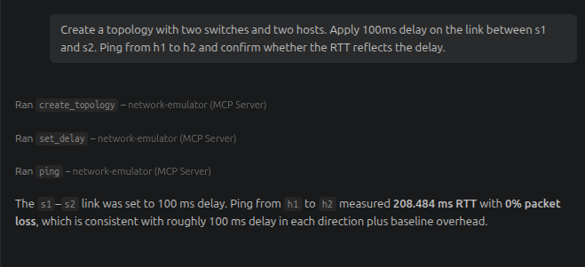
### UC1d: Bandwidth, Packet Loss, and Routing Table

**Prompt:** Create a wired topology with 2 hosts and 1 switch. Set 100 Mbps bandwidth and 5% packet loss on the h1-s1 link. Verify that both settings are applied successfully, then ping from h1 to h2.

**Topology:** Two hosts connected to one switch.

**Expected Result:** The topology is created successfully, both link settings are applied, and connectivity is tested using ping.

**Observed Result**
- Bandwidth was configured at 100 Mbps and packet loss at 5%.
- Ping RTT: 1.364 ms; observed packet loss: 0%.

**Status: PASS** — topology creation, configuration commands, and connectivity test completed successfully. The observed ping loss differed from the configured packet-loss rate.

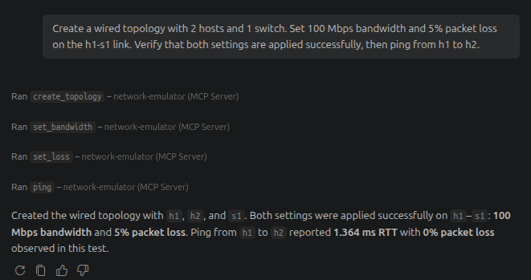

### UC1e: Topology Reporting and Throughput

**Prompt:** Create a wired topology with 4 hosts and 2 switches. After creating the topology, show the actual topology, including all hosts, switches, and links. Then run an iperf throughput test between h1 and h3 and report the measured throughput.

**Topology:** Four hosts connected through two switches.

**Expected Result:** The topology and its links are reported, and throughput between `h1` and `h3` is measured.

**Observed Result**
- The topology contained links `h1–s1`, `h3–s1`, `s1–s2`, `h2–s2`, and `h4–s2`.
- The throughput test between `h1` and `h3` completed with a reported throughput of 44.5 Gbits/sec.

**Status: PASS** — The topology was reported and the throughput test completed.

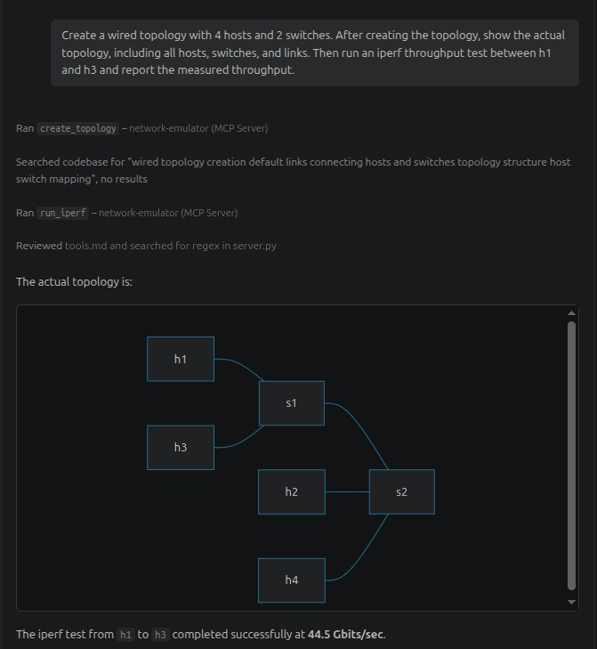

## 2. Wireless Network Use Cases

### UC2a: RSSI Threshold Monitoring

**Prompt:** Create a topology with one access point and two stations. Check signal strength. If any station RSSI is below -70dBm switch the channel

**Topology:** One access point and two wireless stations.

**Expected Result:** The RSSI of both stations is checked. The channel changes only if a station's RSSI is below −70 dBm.

**Observed Result**
- Both stations reported an RSSI of −36 dBm, above the −70 dBm threshold.
- The access point remained on channel 1.

**Status: PASS** — The RSSI threshold was evaluated and no channel change was required.

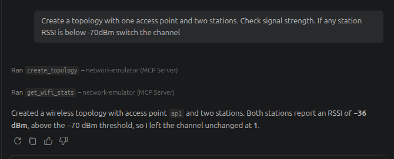

### UC2b: Wi-Fi Channel Switching

**Prompt:** Create a wireless topology with one AP and two stations. Check WiFi channel and signal strength. Switch ap1 to channel 11 and verify stations remain connected.

**Topology:** One access point and two wireless stations.

**Expected Result:** The current channel and signal strengths are checked, `ap1` switches to channel 11, and both stations remain connected.

**Observed Result**
- `ap1` changed from channel 1 to channel 11.
- Both stations remained connected, with RSSI unchanged at −36 dBm.

**Status: PASS** — The channel change and station connectivity were verified.

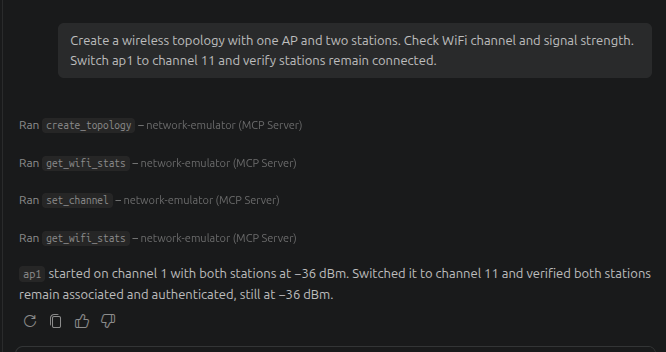

### UC2c: Wireless Throughput Comparison

**Prompt:** Create a wireless topology with one AP and three stations. Run iperf between sta1 and sta2, then sta1 and sta3. Compare throughput

**Topology:** One access point and three wireless stations.

**Expected Result:** Throughput is measured between `sta1–sta2` and `sta1–sta3` and compared.

**Observed Result**
- Throughput between `sta1` and `sta2`: 7.93 Mbit/s.
- Throughput between `sta1` and `sta3`: 7.92 Mbit/s.
- The measured difference was 0.01 Mbit/s.

**Status: PASS** — Both throughput tests completed and their results were compared.

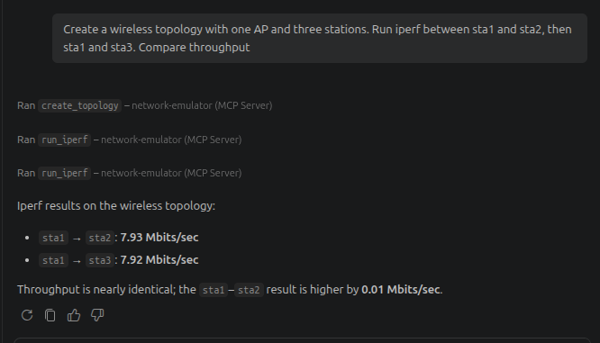

### UC2d: Wi-Fi Station and Access-Point Statistics

**Prompt:** Create a wireless topology with two APs and four stations, two per AP. Check WiFi stats on both APs and summarise which stations are connected to which AP and their signal strength.

**Topology:** Two access points and four wireless stations, with two stations per access point.

**Expected Result:** Statistics identify the stations connected to each access point and their signal strengths.

**Observed Result**
- `ap1` served `sta1` and `sta3`; `ap2` served `sta2` and `sta4`.
- All four stations were associated, authenticated, and authorized.
- All stations reported an RSSI of −36 dBm; both access points were on channel 1.

**Status: PASS** — Station associations and Wi-Fi statistics were retrieved successfully.

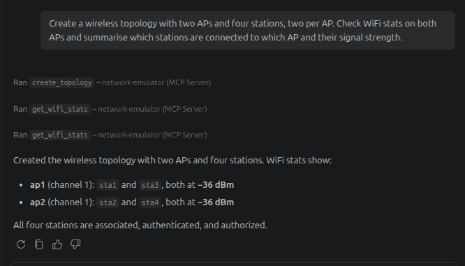

## 3. Hybrid Network Use Cases

### UC3a: Hybrid Network Throughput

**Prompt:** Create a hybrid topology with two wired hosts on a switch and one AP with one station. Run iperf between h1 and sta1 and report throughput

**Topology:** Two wired hosts connected to a switch, with an access point and one wireless station.

**Expected Result:** The hybrid topology is created and throughput between `h1` and `sta1` is measured.

**Observed Result**
- The throughput test between `h1` and `sta1` completed with a reported throughput of 1.21 Gbit/s.

**Status: PASS** — The hybrid topology was created and the throughput test completed.

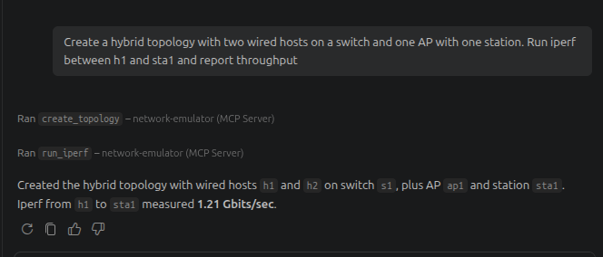

### UC3b: Delay and RTT Verification in a Hybrid Network

**Prompt:** Create a hybrid topology. Ping h1 to sta1 for baseline RTT. Add 100ms delay on h1-s1. Ping again and confirm the RTT increased

**Topology:** A hybrid network containing wired and wireless nodes.

**Expected Result:** The baseline RTT is measured, a 100 ms delay is configured on `h1–s1`, and the RTT is measured again.

**Observed Result**
- Baseline RTT: 5.386 ms.
- RTT after applying the delay: 101.919 ms; packet loss: 0%.
- The RTT increased by approximately 96.5 ms.

**Status: PASS** — The RTT increased substantially after the delay was applied.

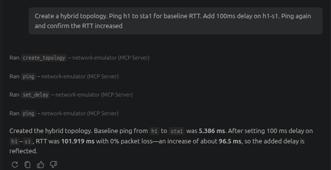

## 4. Mesh Network Use Case

### UC4: Mesh Connectivity

**Prompt:** Create a mesh topology with three wireless mesh nodes. Confirm that traffic can flow between sta1 and sta3 through the mesh network.

**Topology:** Three wireless mesh nodes.

**Expected Result:** Traffic flows successfully between `sta1` and `sta3` through the mesh network.

**Observed Result**
- Ping from `sta1` to `sta3` succeeded.
- Average RTT: 0.120 ms; packet loss: 0%.

**Status: PASS** — Connectivity between the endpoints was verified. The ping result alone does not establish that `sta2` forwarded the traffic as an intermediate relay.

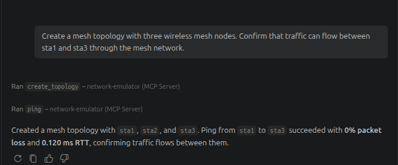

## 5. MCP Natural-Language Prompt Tests

In addition to the 12 use cases, two prompt-template tests were conducted through VS Code Copilot Agent Mode to evaluate predefined workflows for link impairment and Wi-Fi channel configuration.

### 5.1 Workflow

1. Open VS Code Copilot Chat and type `/` to display the available prompt templates.
2. Select `/link_impairment_test` or `/wifi_channel_test`.

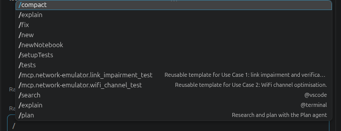
3. Enter the requested parameters, such as host names, delay values, RSSI thresholds, or target channels.
4. Copilot Agent Mode selects the appropriate MCP tools, executes the workflow, and reports the results.

### 5.2 Link Impairment Test

**Prompt Template:** `link_impairment_test`

**Objective:** Create a hybrid topology, measure baseline RTT, apply a 50 ms delay to `h1–s1`, and measure RTT again.

**Observed Result**
- Baseline RTT: 5.899 ms.
- RTT after applying the delay: 52.101 ms.
- The RTT increased by 46.202 ms; packet loss was 0% in both tests.

**Status: PASS** — The workflow completed and the measured RTT increased after the delay was applied.

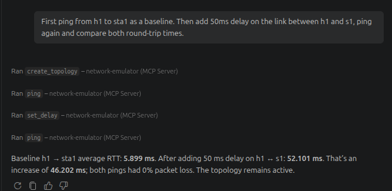

### 5.3 Wi-Fi Channel Test

**Prompt Template:** `wifi_channel_test`

**Objective:** Evaluate station RSSI against a −30 dBm threshold and switch `ap1` to channel 11 if the condition is met.

**Observed Result**
- A wireless topology was created because no active topology existed.
- Both stations reported an RSSI of −36 dBm, meeting the condition for channel switching.
- `ap1` switched to channel 11; the RSSI remained −36 dBm for both stations.

**Status: PASS** — The RSSI condition was evaluated and the channel change was completed. No improvement in RSSI was observed.

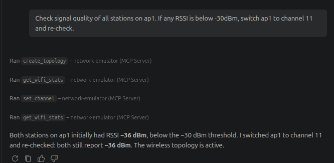

## 6. Summary

| Category  | Use Cases                    | Result |
| --------- | ---------------------------- | ------ |
| Wired     | UC1a, UC1b, UC1c, UC1d, UC1e | 5/5 ✅ |
| Wireless  | UC2a, UC2b, UC2c, UC2d       | 4/4 ✅ |
| Hybrid    | UC3a, UC3b                   | 2/2 ✅ |
| Mesh      | UC4                          | 1/1 ✅ |
| **Total** | **12 use cases**             | **12/12 ✅** |

The evaluation demonstrated that the MCP server could execute the defined use cases through natural-language prompts and retrieve results across wired, wireless, hybrid, and mesh network scenarios. The two additional prompt-template tests also completed their intended workflows.

### Observed Limitations

- **Inter-switch delay:** Interface inspection confirmed that the 100 ms netem delay was applied to the actual inter-switch interface `s1-eth2`.
- **Packet loss:** UC1d configured 5% packet loss, while the observed ping test reported 0% loss.
- **Mesh forwarding:** UC4 verified endpoint connectivity, but did not establish that `sta2` acted as an intermediate relay.
- **Measurement variability:** Throughput and RTT values represent individual test runs and may vary across runs.

## 7. Conclusion

The evaluation shows that natural-language interaction through VS Code Copilot Agent Mode can make common emulated-network operations accessible without requiring users to issue CLI commands or run scripts themselves. The results also highlight the importance of verifying the resulting network behaviour, rather than relying solely on successful tool execution, when evaluating network automation.
